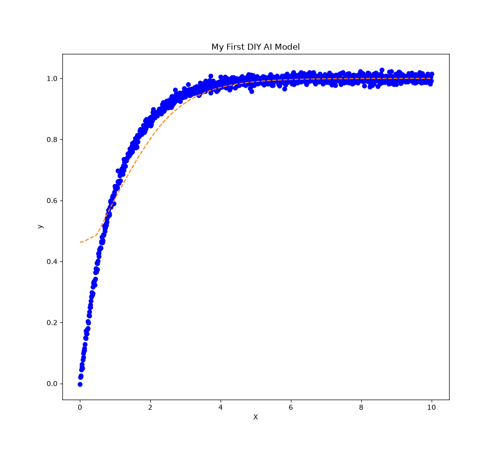

# MY FIRST AI MODEL THAT I'VE EVER MADE WITHOUT TENSORFLOW, PYTORCH, NUMPY, AND PANDAS

(blue: True Data | orange: Predicted Data)

In this repo, I've made an AI architecture like usual, but in this time, I made it without ~~`pip install numpy pandas tensorflow pytorch`.~~
The only Python libraries that were installed on the virtual environment are `joblib` and `matplotlib`. 
So, I made the algorithm purely lies on standard Python functions and syntax, and I also use standard Python libraries like `math` and `random`. 
I made the Glorot Initialization, forward pass, backpropagation, Vanilla GD, and so on manually. 
And it works! And now my brain know, what's inside the AI algorithms.

#### 🧠 Model Specs
- **Architecture:** 1-15-1 Shallow Feedforward
  - Input: 1D (x)
  - Hidden: 15 neurons, Activation **ReLU**
  - Output: 1 neuron, Activation **Sigmoid** (0-1 bounded)
  - Total Params: 31 (`w1=15, b1=15, w2=15, b2=1`)
- **Initialization:** Glorot Uniform `U[-sqrt(6/(fan_in+fan_out)), +sqrt(...)]`
- **Implementation:** Pure Python lists & math. No autograd.

#### 📊 Dataset
- **Custom Data Loader:** `datagen.py` (no pandas)
- **Physics Law:** `y = 1 - exp(-x) + GaussianNoise(0, 0.01)`
- **Range:** x in, saturation to 1 

#### ⚙️ Training
- **Optimizer:** Full-Batch Vanilla Gradient Descent (the OG optimizer)
  - `w = w - lr * mean(grad_all_data)`
  - No momentum, no Adam. Deterministic & smooth.
- **Loss:** Mean Squared Error (MSE)
- **Gradient:** Manual backprop derived on paper:
  - `grad_sigmoid`, `grad_relu`, `chain rule w2 * grad_relu * x`
- **Hyperparams:**
  - `lr = 1e-3` (sweet spot)
  - `epochs = 10,000`

#### 📈 Results
See on `train_history.txt`

#### 🛠️ Tech Stack
- **Core AI:** 100% Pure Python
- **Helpers only:** `matplotlib` (plotting), `joblib` (save/load)
- **Files:** `datagen.py`, `neural.py`, `train.py`, `plot.py`

> Built from paper to code. No `pip install AI frameworks` and no AI agents used on writing code. This is purely my brain's deep work.